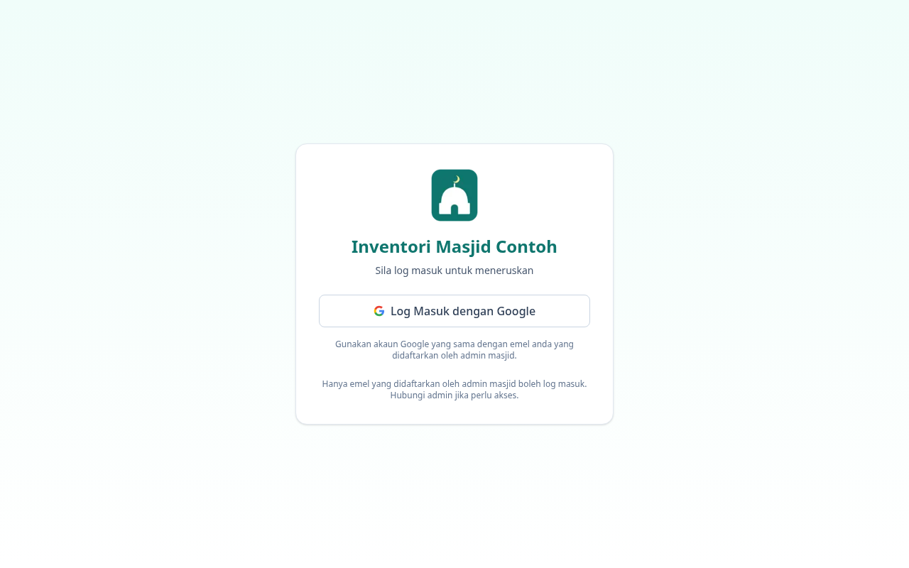
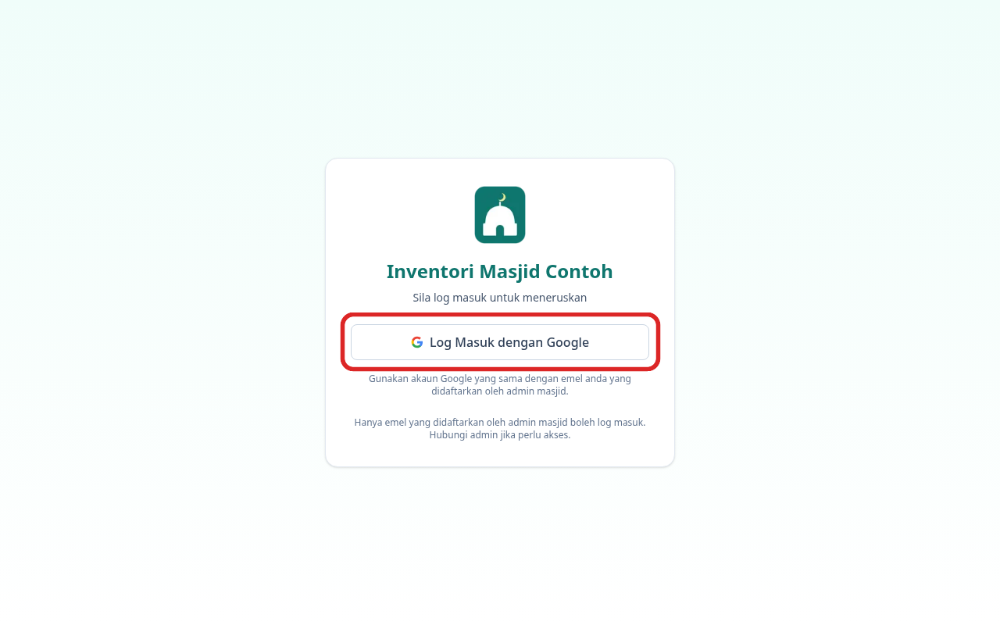
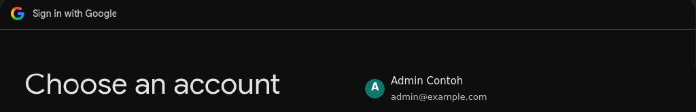
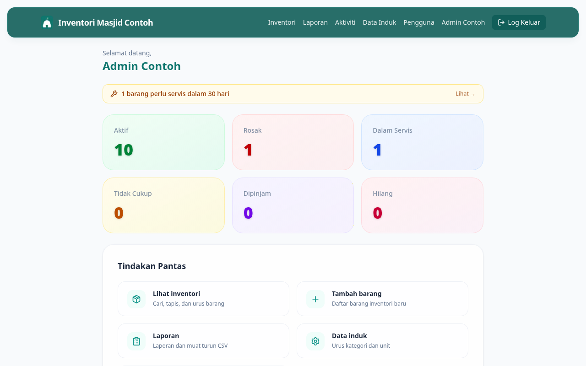

# 01 — Cara Log Masuk

**Bila perlu guna panduan ni:** Kali pertama nak masuk sistem, atau bila session dah expired dan kena log masuk semula.

**Yang anda perlukan:** Akaun Google (Gmail) yang Admin masjid dah daftar dalam sistem. Kalau tak pasti akaun mana, tanya Admin dulu.

---

## Langkah-langkah

### 1. Buka URL sistem

Dalam browser (Chrome paling sesuai), taip:

```
inventori.example.com
```

Anda akan nampak page Log Masuk dengan satu butang biru besar.



### 2. Klik **Log Masuk dengan Google**

Tekan butang biru tu sekali. Jangan double-click.



### 3. Pilih akaun Google anda

Google akan tunjuk senarai akaun yang dah login dalam Chrome ni. Pilih yang DAH DIDAFTARKAN sebagai AJK.

Kalau akaun tu tak nampak, klik **Use another account** dan masukkan email + password.



### 4. Tunggu sebentar

Sistem akan check akaun anda, lepas tu bawak terus ke Dashboard. Kalau berjaya, anda akan nampak nombor barang Aktif, Dipinjam, Rosak di tengah skrin.



---

## Kalau tak boleh login

**"Akses ditolak" atau page kosong selepas pilih akaun Google?**
Akaun anda belum didaftarkan dalam sistem. Hantar email Gmail anda kat Admin, mintak dia tambah.

**Browser keep ask login balik-balik?**
Kemungkinan cookies tersekat. Cuba:
1. Buka Chrome dalam mode Incognito (Ctrl+Shift+N)
2. Pergi `inventori.example.com` semula
3. Log masuk

Kalau jadi dalam Incognito tapi tak jadi dalam Chrome biasa, clear cookies untuk site `example.com` dalam Chrome settings.

**Page nampak strange, button hilang?**
Refresh page (F5 atau Ctrl+R). Kalau masih sama, screenshot dan WhatsApp kat Admin.

---

## Lepas ni

Dah login? Pergi panduan **[02 — Kenali Dashboard](02-dashboard-tour.md)** untuk faham apa setiap angka pada page utama tu maksudnya.
