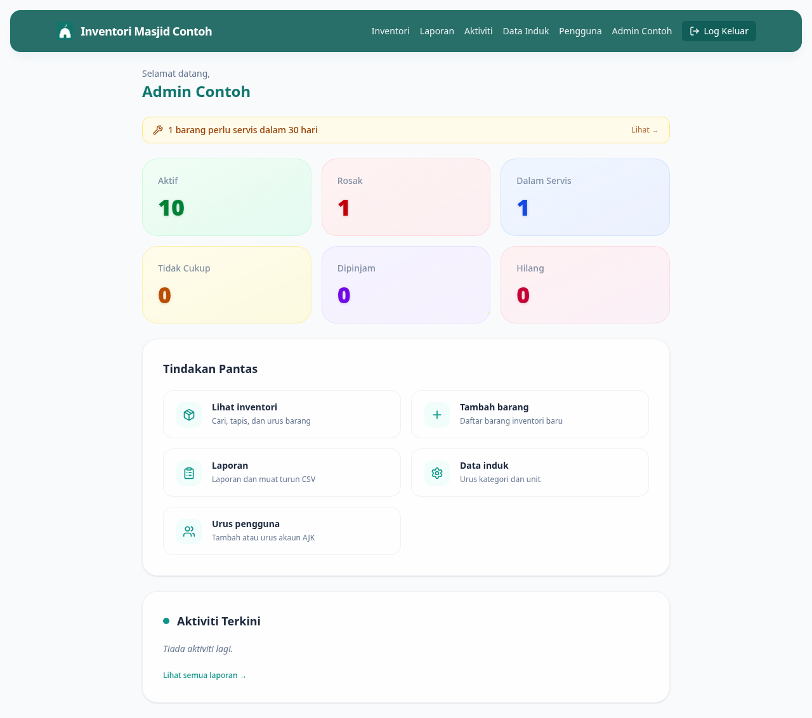

# 02 — Kenali Dashboard

**Bila perlu guna panduan ni:** Lepas log masuk kali pertama, atau bila nak faham apa setiap angka kat page utama tu maksudnya.

---

## Yang anda nampak

### 1. Sapaan di atas sekali

Nama anda akan muncul di bahagian atas. Kalau nama salah, buka panduan **[Tukar Profil]** (atau tanya Admin).

### 2. Alerts (kotak warna kuning / oren / biru)

Kalau ada barang yang perlu perhatian (perlu servis, hampir luput, atau sedang dipinjam), kotak alert akan muncul di atas. Klik kotak tu untuk terus pergi senarai barang berkenaan.

Kalau tak ada alert, kotak ni takkan muncul — bermakna semua OK.

### 3. Stat Cards — 6 kotak warna

Setiap kotak tunjuk berapa banyak barang dalam status tu:

| Kotak | Maksud |
|-------|--------|
| **Aktif** (hijau) | Barang yang OK, boleh guna |
| **Rosak** (merah) | Barang yang rosak, belum dibaiki |
| **Dalam Servis** (biru) | Barang yang sedang dibaiki / diservis |
| **Tidak Cukup** (kuning) | Stok kurang dari kuantiti minimum |
| **Dipinjam** (ungu) | Barang sedang dipinjam keluar |
| **Hilang** (rose) | Barang yang hilang / dicuri |

### 4. Tindakan Pantas

Shortcut ke aktiviti yang paling kerap dibuat — Lihat inventori, Tambah barang, Laporan, Data induk. Klik sahaja yang anda nak.

---

## Kalau tak boleh lihat dashboard

**Page kosong selepas log masuk?**
Refresh page (F5 atau Ctrl+R). Kalau masih kosong, log keluar dan log masuk semula.

**Nampak angka 0 untuk semua kotak?**
Sistem belum ada barang — pergi panduan **[05 — Tambah Barang Baru](05-tambah-item.md)** untuk daftar barang pertama.

---

## Lepas ni

Nak cari barang tertentu? Pergi **[03 — Cari Barang](03-cari-item.md)**.
