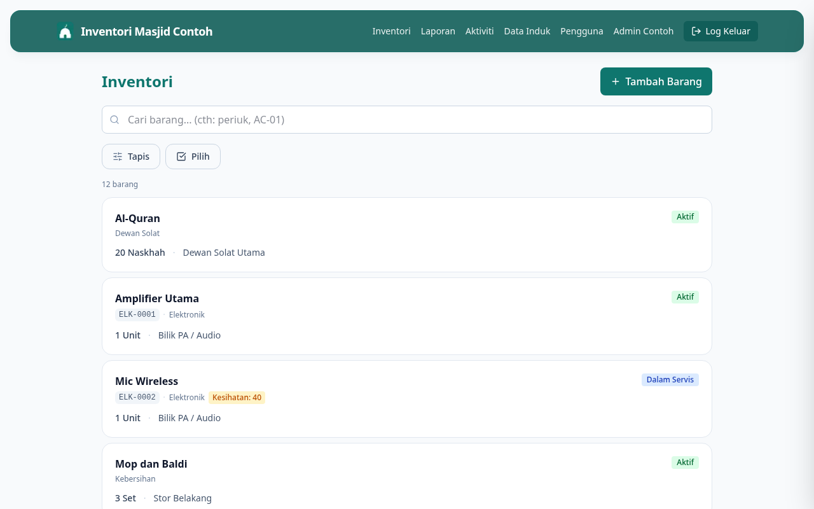

# 03 — Cari Barang

**Bila perlu guna panduan ni:** Nak cari satu barang tertentu, atau nak tapis senarai ikut kategori / lokasi / status.

---

## Langkah-langkah

### 1. Buka senarai barang

Dari Dashboard, klik **Lihat inventori** dalam Tindakan Pantas. Atau dari menu atas, klik **Inventori**.

### 2. Cara cepat — taip dalam kotak Carian

Di atas senarai, ada kotak carian dengan placeholder "Cari barang... (cth: periuk, AC-01)". Taip apa-apa — nama barang, sebahagian nama, atau kod aset.

Senarai akan auto-filter sambil anda menaip.

### 3. Cara terperinci — guna Filter

Klik butang **Filter** (ikon slider) di sebelah kanan kotak carian. Panel akan muncul dari kanan dengan 4 pilihan tapisan:

- **Kategori** — cth: Dapur, Dewan Solat, Sound System
- **Lokasi** — di mana barang disimpan
- **Status** — Aktif, Rosak, Dipinjam, dll.
- **Keadaan fizikal** — Baik, Sederhana, Rosak

Pilih satu atau lebih, klik **Sah** atau klik luar panel.

### 4. Buang tapisan

Bila ada tapisan aktif, butang **Filter** akan tunjuk angka (cth: "Filter 2"). Klik butang **Kosongkan** di sebelahnya untuk reset semua tapisan dan carian.

---

## Kalau tak boleh cari barang

**Taip tapi tak nampak hasil?**
- Pastikan ejaan betul (cth: "periuk" bukan "priok")
- Cuba potong perkataan (cth: "AC" je instead of "AC-01")
- Buang tapisan dulu — mungkin barang anda tersangkut dalam tapisan lain

**Nampak "Tiada barang dijumpai"?**
- Klik **Kosongkan** untuk reset semua tapisan
- Kalau memang tak ada, mungkin barang belum didaftarkan — tanya Admin

---

## Lepas ni

Dah jumpa barang? Klik nama dia untuk lihat detail. Pergi **[04 — Lihat Detail Barang](04-lihat-detail-item.md)**.
