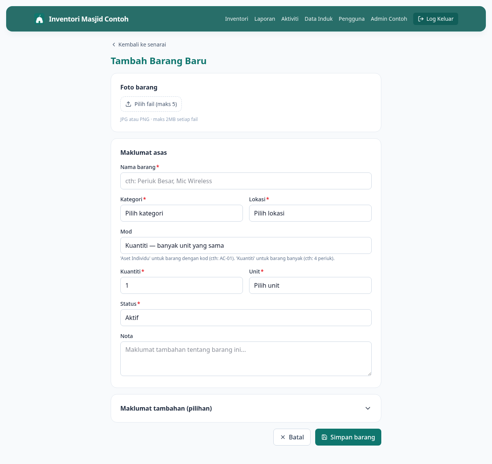

# 05 — Tambah Barang Baru

> **Untuk Admin sahaja.** Kalau anda AJK biasa, butang ni takkan muncul.

**Bila perlu guna panduan ni:** Ada barang baru masuk inventori — beli, dapat sumbangan, atau jumpa barang lama yang belum daftar.

---

## Langkah-langkah

### 1. Buka form Tambah Barang

Dari Dashboard, klik **Tambah barang** dalam Tindakan Pantas. Atau dari senarai inventori, klik butang **+ Tambah** di atas kanan.

### 2. Isi info wajib

Field yang ada tanda `*` mesti diisi:

- **Nama barang** — cth: "Periuk Besar Aluminium"
- **Kategori** — pilih dari dropdown (cth: Dapur, Dewan Solat). Kalau tak ada, tambah dulu dalam **[Data Induk](14-uruskan-master-data.md)**
- **Lokasi** — di mana barang disimpan
- **Mod** — pilih:
  - **Aset Individu** — kalau barang ada kod unik (cth: AC-01, satu unit besar)
  - **Kuantiti** — kalau ramai barang sama (cth: 30 periuk, 100 cawan)
- **Kuantiti** + **Unit** (kalau mod Kuantiti) — cth: 30 unit, 5 ela
- **Status** — biasa "Aktif" untuk barang baru
- **Kod aset** — kosongkan, sistem auto-jana (cth: DPR-0001)

### 3. Maklumat tambahan (boleh skip dulu, kemaskini later)

Scroll ke bawah, expand **Maklumat tambahan**:

- **Tarikh perolehan** + **Harga (RM)** — penting untuk audit
- **Kaedah perolehan** — Beli / Sewa / Sumbangan
- **Pembekal** — kedai / orang yang bagi
- **No. Resit / Rujukan** — untuk rekod kewangan
- **Jaminan luput** — tarikh warranty habis
- **Jangkaan hayat** — berapa tahun barang ni dijangka tahan
- **Selang servis** — peringatan servis tiap berapa hari
- **Kuantiti minimum** — amaran bila stok kurang dari ni

### 4. Upload foto + Simpan

Tarik foto barang ke kotak upload, atau klik untuk pilih file. Boleh upload lebih dari satu.

Klik **Simpan** di bawah sekali. Sistem akan generate kod aset auto dan bawak anda ke page detail barang yang baru daftar.

---

## Kalau tak boleh tambah barang

**Dropdown Kategori atau Lokasi kosong?**
Belum ada data induk. Pergi **[14 — Uruskan Kategori & Lokasi](14-uruskan-master-data.md)** untuk tambah dulu.

**Error "Kod aset dah wujud"?**
Kosongkan field Kod Aset — biar sistem auto-jana.

**Upload foto stuck?**
- Saiz foto besar sangat? Cuba bawah 5MB satu foto
- Internet slow? Refresh dan cuba sekali lagi
- Format pelik (HEIC dari iPhone)? Tukar ke JPEG dulu

---

## Lepas ni

- Nak edit barang yang baru daftar? Pergi **[06 — Edit Barang](06-edit-item.md)**
- Nak cetak QR label untuk tampal pada barang? Pergi **[10 — Cetak Label QR](10-cetak-qr.md)**
