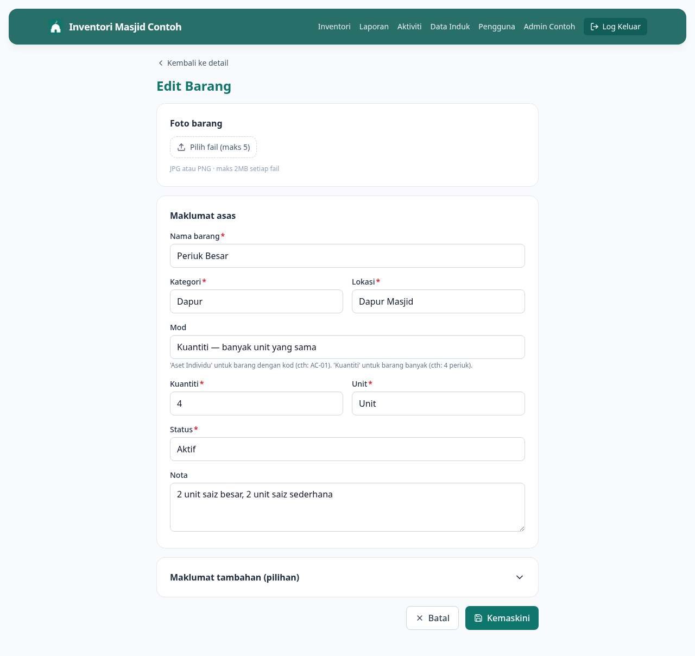

# 06 — Edit Barang

> **Untuk Admin sahaja.**

**Bila perlu guna panduan ni:** Kemaskini info barang yang dah ada — tukar nama, tambah foto, betulkan harga, update jaminan, atau letak kuantiti minimum.

---

## Langkah-langkah

### 1. Buka page detail barang

Cari barang dalam senarai inventori, klik untuk masuk page detail.

### 2. Klik butang **Edit**

Di bahagian atas page detail, ada butang **Edit** (ikon pencil). Klik untuk masuk form edit.

URL akan jadi `/items/{id}/edit`.

### 3. Ubah apa yang perlu

Form ni sama macam form Tambah Barang, tapi semua field dah terisi dengan info semasa. Ubah apa yang anda nak — yang lain biar je.

**Tip:** Untuk perubahan kecil je (cth: betulkan ejaan nama), jangan ubah field lain. Lagi banyak ubah, lagi tinggi risiko silap.

### 4. Tukar / tambah foto

Foto-foto sedia ada akan tunjuk di atas. Klik **X** pada mana-mana foto untuk buang. Tarik atau klik kotak upload untuk tambah foto baru.

### 5. Simpan

Klik **Simpan** di bawah. Anda akan dibawa balik ke page detail dengan info terkini.

---

## Kalau tak boleh edit

**Butang Edit tak nampak?**
Anda bukan Admin. Hanya Admin boleh edit. Kalau anda perasan info salah, WhatsApp Admin.

**Status terkunci, tak boleh tukar?**
Sesetengah status (cth: Dipinjam, Dilupuskan) cuma boleh ditukar melalui tindakan tertentu — bukan edit form. Cth:
- Untuk tukar dari **Dipinjam** ke **Aktif**, guna butang **Pulang** di page detail
- Untuk tukar dari **Aktif** ke **Dilupuskan**, guna form **Lupus**
- Untuk tandai **Hilang**, guna form **Lapor Hilang**

**Foto tak naik?**
Saiz besar sangat. Compress dulu, atau buang foto lama dulu sebelum upload baru.

---

## Lepas ni

- Status barang berubah? Pergi **[11 — Lapor Rosak atau Hilang](11-lapor-rosak-hilang.md)**
- Barang dah rosak teruk, nak lupus? Hubungi Admin senior (tindakan ni serius — perlu approval)
