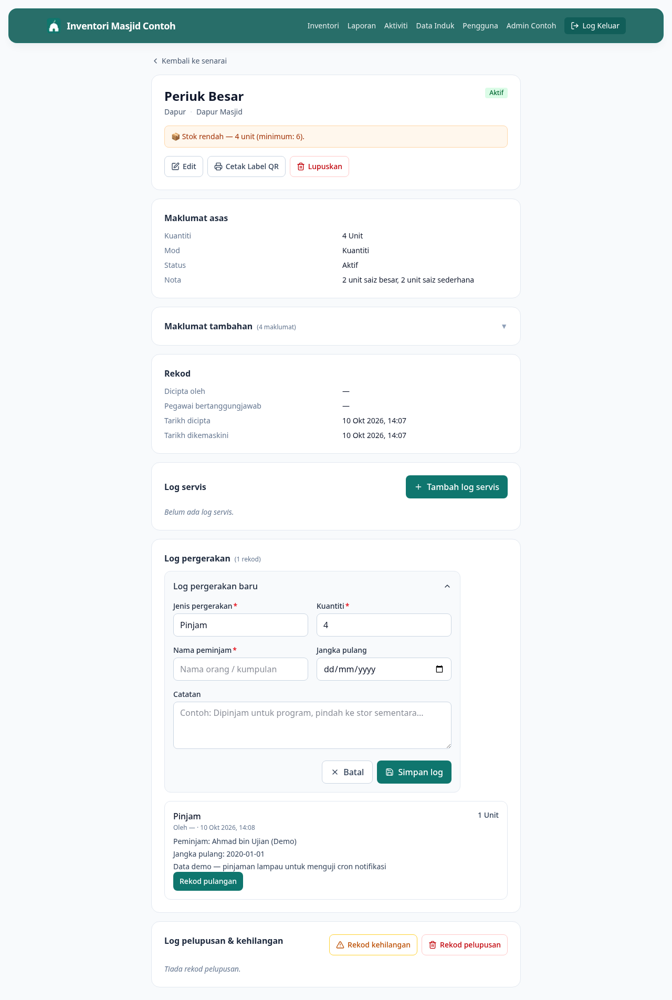

# 07 — Rekod Pinjam Barang

**Bila perlu guna panduan ni:** Ada orang nak pinjam barang masjid (cth: pinjam meja untuk program, pinjam periuk untuk kenduri). Rekod supaya barang tu kita boleh track balik.

---

## Langkah-langkah

### 1. Buka page detail barang yang nak dipinjam

Cari barang dalam senarai inventori, klik untuk buka page detail.

### 2. Klik butang **Rekod Pergerakan**

Di page detail, klik butang **Rekod Pergerakan** (warna primary, biasanya biru/hijau). Form akan keluar.

### 3. Pilih jenis pergerakan → **Pinjam**

Field **Jenis pergerakan**, pilih **Pinjam**.

(Pilihan lain: Pulang, Pindah Lokasi — guna untuk kes lain.)

### 4. Isi info pinjam

- **Kuantiti** — berapa unit dipinjam (kalau mod Kuantiti). Untuk Aset Individu, automatik 1.
- **Nama peminjam** *(wajib)* — nama penuh orang yang pinjam, atau nama kumpulan (cth: "Ustaz Razak", "AJK Khairat 2026")
- **Jangka pulang** — tarikh dijanji nak pulang (boleh kosongkan kalau tak pasti)
- **Catatan** — sebab pinjam, atau apa-apa info tambahan (cth: "Untuk program berbuka puasa 25 Mac")

### 5. Klik **Simpan**

Sistem akan:
- Tukar status barang jadi **Dipinjam**
- Catat rekod dalam Sejarah Pergerakan
- Kira balik kuantiti yang ada (kalau mod Kuantiti)

Anda akan nampak rekod baru muncul di bahagian Sejarah Pergerakan, page detail.

---

## Kalau tak boleh rekod pinjam

**Butang Rekod Pergerakan grey / tak boleh klik?**
Barang dah dalam status yang tak boleh dipinjam — cth: Rosak, Dalam Servis, Hilang, Dilupuskan. Tukar status dulu atau pilih barang lain.

**Error "Kuantiti melebihi yang ada"?**
Anda taip lebih dari stok semasa. Cek dulu berapa unit yang ada dalam page detail.

**Lupa isi nama peminjam?**
Form takkan submit. Nama peminjam memang wajib — supaya boleh kejar bila tak pulang.

---

## Lepas ni

- Bila barang dipulangkan, pergi **[08 — Rekod Pulang Barang](08-pulang-barang.md)**
- Nak tengok semua barang yang sedang dipinjam? Pergi `/reports/dipinjam` (atau **[12 — Lihat Laporan](12-lihat-laporan.md)**)
