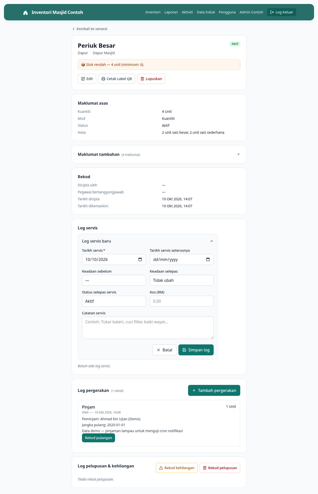

# 09 — Rekod Servis / Maintenance

**Bila perlu guna panduan ni:** Barang dah dibaiki, diservis, atau dijaga (cth: AC dicuci, periuk gas tukar regulator, sound system kalibrate). Catat supaya ada rekod, dan sistem boleh ingatkan bila next servis.

---

## Langkah-langkah

### 1. Buka page detail barang

Cari barang dalam senarai, klik untuk buka detail.

### 2. Klik butang **Rekod Servis**

Di bahagian butang tindakan, klik **Rekod Servis**. Form akan keluar.

### 3. Isi info servis

- **Tarikh servis** *(wajib)* — bila servis dibuat
- **Tarikh servis seterusnya** — bila next servis perlu (sistem akan bagi peringatan)
- **Keadaan sebelum** — Baik / Sederhana / Rosak (sebelum servis)
- **Keadaan selepas** — selepas servis (biasa lebih baik)
- **Status selepas servis** — biasa "Aktif", atau "Dalam Servis" kalau masih kena hantar
- **Kos (RM)** — berapa habis untuk servis ni
- **Catatan servis** — apa yang dibuat, contoh: "Tukar bateri, cuci filter, baiki wayar"

### 4. Klik **Simpan**

Sistem akan:
- Catat rekod servis dalam Sejarah Servis
- Tukar status barang ikut pilihan "Status selepas servis"
- Set peringatan next servis (kalau ada tarikh seterusnya)

---

## Bila guna "Selang servis" vs "Tarikh servis seterusnya"?

- **Selang servis** (set dalam form Edit Barang) = peringatan automatik tiap X hari dari tarikh servis terakhir. Cth: AC perlu cuci tiap 90 hari.
- **Tarikh servis seterusnya** (set masa rekod servis ni) = peringatan one-off untuk servis spesifik. Cth: "Tukar tayar wheelchair pada 15 Jun".

Boleh guna dua-dua bersama.

---

## Kalau tak boleh rekod servis

**Butang Rekod Servis tak nampak?**
Pastikan anda dah login. Kalau dah login dan masih tak nampak, refresh page.

**Status barang masih sama selepas simpan?**
Anda mungkin set "Status selepas servis" kepada status semasa. Cek balik dalam form.

**Lupa nak catat servis lama (cth: dari bulan lepas)?**
OK je — set "Tarikh servis" kepada tarikh sebenar (boleh backdate). Sistem terima.

---

## Lepas ni

- Nak lihat semua barang yang perlu servis dalam masa terdekat? Pergi `/reports/perlu-servis`
- Nak set selang servis automatik? Pergi **[06 — Edit Barang](06-edit-item.md)**, set field "Selang servis (hari)"
