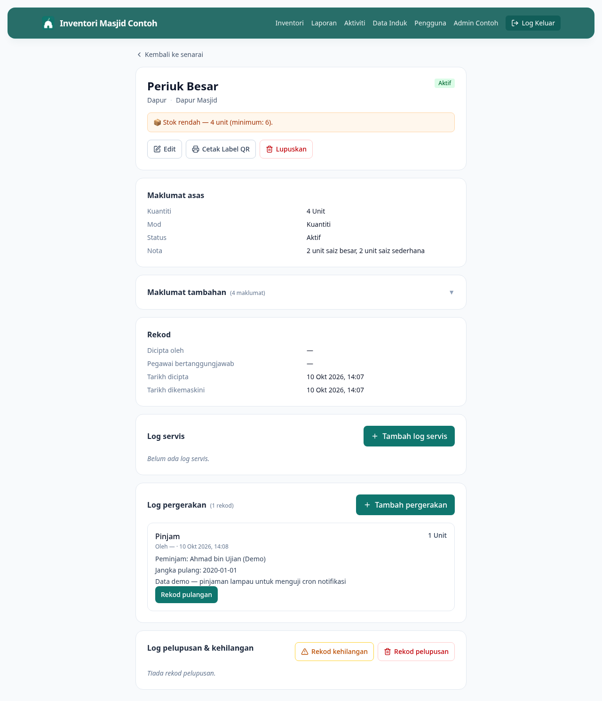

# 10 — Cetak Label QR

**Bila perlu guna panduan ni:** Nak tampal label QR pada barang fizikal supaya AJK boleh scan terus pakai phone dan dapat info barang tu.

---

## Langkah-langkah

### 1. Buka page detail barang

Cari barang dalam senarai, klik untuk buka page detail.

### 2. Klik butang **Cetak Label QR**

Di bahagian butang tindakan (atas page), ada butang **Cetak Label QR** (ikon printer).

### 3. Tetingkap print akan keluar

Browser akan buka print dialog. Anda akan nampak preview label QR — mengandungi:
- Nama barang
- Kod aset (cth: DPR-0001)
- QR code yang point ke URL barang ni dalam sistem

> Screenshot print preview perlu ditambah manual nanti (`screenshots/10-cetak-qr/step-2.png`).

### 4. Set printer + saiz, lepas tu Print

Pilih:
- **Printer** — printer masjid, atau "Save as PDF" kalau nak simpan dulu
- **Paper size** — A4 OK, atau label sticker khas
- **Margins** — Minimum atau Default

Klik **Print**.

> Screenshot print dialog perlu ditambah manual nanti (`screenshots/10-cetak-qr/step-3.png`).

### 5. Potong + tampal pada barang

Selepas cetak, potong label dan tampal pada barang fizikal di tempat yang senang nampak (cth: belakang AC, atas periuk, tepi sound system).

**Tip:** Tampal sebelah lain dari kawasan yang basah / panas / kena gesek selalu — supaya tahan lama.

---

## Bila scan QR, apa jadi?

Scan QR dengan camera phone (Chrome / Safari). Akan buka URL barang dalam browser. Kalau peminjam dah login akaun masjid, dia akan terus nampak page detail. Kalau belum login, akan minta log masuk dulu.

---

## Kalau tak boleh cetak QR

**Print dialog tak keluar?**
- Browser anda mungkin block pop-up. Allow pop-up untuk `inventori.example.com` dalam browser settings.
- Cuba Chrome — lebih reliable untuk print dialog.

**QR scan tapi tak buka apa-apa?**
- Phone tak ada internet — sambung WiFi masjid dulu
- Camera tak detect QR — bersihkan camera lens, atau pakai app QR scanner berasingan

**QR scan buka tapi minta login balik-balik?**
Phone tak ada cookies sistem. Login sekali dalam Chrome phone, lepas tu scan akan terus jalan.

---

## Lepas ni

Dah tampal semua label QR? Cuba scan satu untuk pastikan jalan. Lepas tu sebar dalam grup AJK — supaya semua orang tahu boleh scan.
