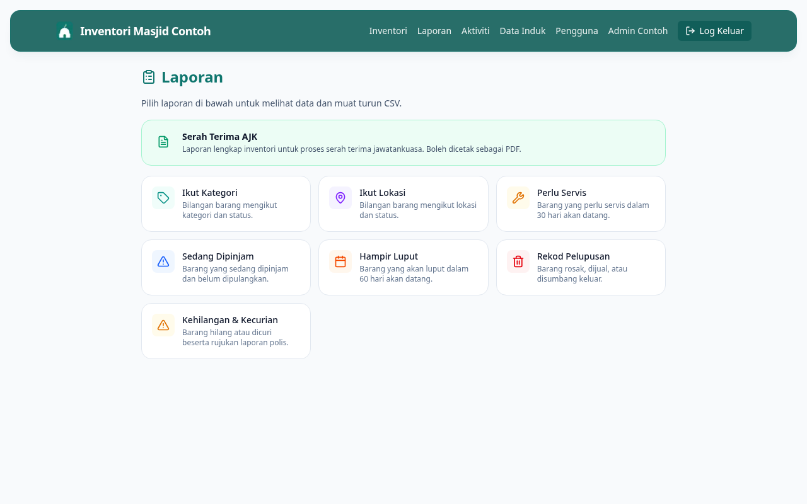

# 12 — Lihat Laporan

**Bila perlu guna panduan ni:** Nak tengok ringkasan inventori — apa yang dipinjam, apa yang perlu servis, apa yang hampir luput, sejarah pelupusan, dan banyak lagi.

---

## Langkah-langkah

### 1. Buka page Laporan

Dari menu atas, klik **Laporan**. Atau dari Dashboard, klik **Laporan** dalam Tindakan Pantas.

URL: `/reports`

### 2. Pilih jenis laporan

Anda akan nampak beberapa kad laporan:

| Laporan | Apa di dalam |
|---------|--------------|
| **Ikut Kategori** | Senarai barang dipecahkan ikut kategori (Dapur, Sound, dll.) |
| **Ikut Lokasi** | Senarai barang dipecahkan ikut tempat simpanan |
| **Perlu Servis** | Barang yang dah lambat untuk servis seterusnya |
| **Sedang Dipinjam** | Semua barang yang outstanding (belum pulang) |
| **Hampir Luput** | Barang dengan tarikh luput / jaminan dalam 60 hari |
| **Rekod Pelupusan** | Sejarah semua barang yang dah dilupuskan |
| **Kehilangan & Kecurian** | Sejarah barang hilang / dicuri |
| **Serah Terima AJK** | Laporan lengkap untuk handover jawatankuasa (lihat panduan 13) |

Klik kad untuk masuk laporan tu.

### 3. Lihat laporan + Muat turun CSV

Setiap laporan tunjuk senarai dalam jadual. Anda boleh:

- **Scroll** untuk tengok semua
- **Muat turun CSV** — butang di atas kanan. Open dalam Excel / Google Sheets.

### 4. Klik nama barang untuk masuk detail

Dari laporan, klik nama barang untuk terus ke page detail dia. Senang nak ambil tindakan terus.

---

## Kalau tak boleh lihat laporan

**Page Laporan kosong, tak ada kad?**
Refresh page (F5). Kalau masih kosong, log keluar dan log masuk semula.

**Klik kad tapi laporan kosong?**
Memang tak ada data — cth: kalau "Sedang Dipinjam" kosong, bermakna tiada barang outstanding sekarang. Bagus!

**Muat turun CSV buka jadi bahasa pelik dalam Excel?**
Excel encoding issue. Cuba:
1. Open Excel kosong dulu
2. Data → From Text/CSV → pilih file CSV
3. Pilih encoding "UTF-8"

---

## Lepas ni

- Nak laporan handover untuk serah AJK baru? Pergi **[13 — Buat Laporan Serah Terima AJK](13-serah-terima-ajk.md)**
- Nak audit pelupusan? Pergi `/reports/pelupusan` terus
