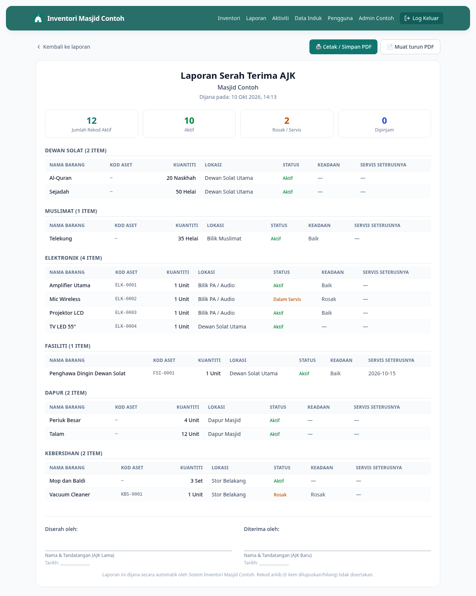
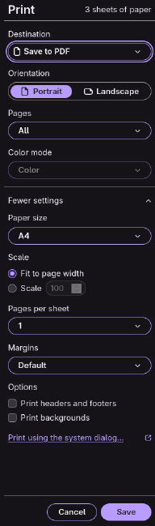

# 13 — Buat Laporan Serah Terima AJK

> **Untuk Admin sahaja.** Biasanya digunakan sekali setahun semasa AGM atau bila AJK baru ambil alih.

**Bila perlu guna panduan ni:** Nak hasilkan laporan lengkap inventori masjid untuk diserahkan kepada AJK baru — sebagai bukti rasmi apa yang ada, dalam keadaan apa, dan di mana.

---

## Langkah-langkah

### 1. Buka page Laporan Serah Terima

Dari menu atas, klik **Laporan**, lepas tu klik kad **Serah Terima AJK** di atas (kad besar dengan label "Laporan lengkap").

URL: `/reports/handover`

### 2. Tengok ringkasan di atas

Bahagian atas tunjuk angka summary:
- **Jumlah Rekod Aktif** — semua barang dalam inventori
- **Aktif** — barang dalam keadaan baik
- **Rosak / Servis** — barang yang ada isu
- **Dipinjam** — barang outstanding

Pastikan angka ni reasonable sebelum cetak.

### 3. Scroll ke bawah — senarai penuh

Laporan ni mengandungi:
- Semua barang aktif, dipecah ikut kategori dan lokasi
- Kod aset, status, keadaan, lokasi semasa
- Tanda tangan + tarikh untuk AJK lama dan AJK baru di bawah sekali

### 4. Cetak / Save sebagai PDF

Tekan **Ctrl+P** (atau Cmd+P pada Mac). Print dialog akan keluar.

- **Destination:** Pilih printer, atau **Save as PDF**
- **Layout:** Portrait
- **Paper:** A4
- **Margins:** Default
- **Headers and footers:** OFF (untuk laporan rasmi lebih kemas)

Klik **Print** atau **Save**.

### 5. Hantar PDF ke AJK baru

Forward PDF tu dalam grup WhatsApp AJK, atau email kepada Pengerusi baru. Print versi keras untuk ditandatangani dan simpan dalam fail masjid.

---

## Kalau tak boleh buat laporan handover

**Kad "Serah Terima AJK" tak nampak dalam page Laporan?**
Anda bukan Admin. Hanya Admin boleh akses laporan ni.

**Print dialog tak keluar?**
- Browser block pop-up — allow pop-up untuk site ni
- Atau cuba browser lain (Chrome paling reliable)

**PDF terlalu panjang / banyak page kosong?**
- Dalam print dialog, set "Margins: Minimum" dan "Scale: Fit to page"
- Toggle "Headers and footers" OFF

**Angka tak match dengan stocktake fizikal?**
- Ada barang yang dilupuskan tapi belum dicatat? Pergi **[11 — Lapor Rosak atau Hilang](11-lapor-rosak-hilang.md)**
- Ada barang baru beli tapi belum daftar? Pergi **[05 — Tambah Barang](05-tambah-item.md)**
- Buat reconciliation dulu sebelum cetak handover rasmi

---

## Lepas ni

Selepas serah terima, AJK baru perlu log masuk dengan akaun Google masing-masing. Pastikan akaun mereka dah didaftarkan dalam sistem. Pergi **[Uruskan Pengguna]** atau hubungi Admin teknikal.
