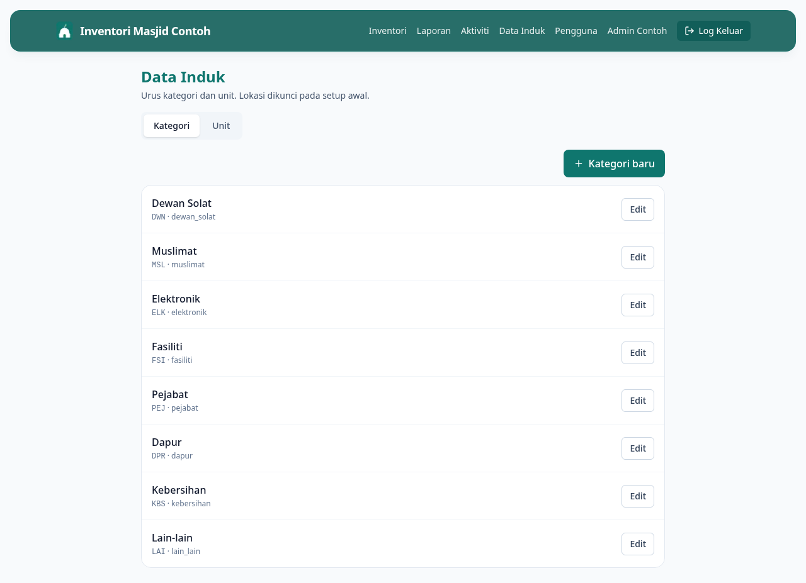

# 14 — Uruskan Kategori & Unit (Data Induk)

**Bila perlu guna panduan ni:** Nak tambah kategori baru (cth: "Peralatan Aircond"), unit baru (cth: "ela", "gulung"), atau ubah yang sedia ada.

> **Nota:** Lokasi adalah locked pada setup awal — tak boleh diubah dari sini. Hubungi developer kalau perlu tambah lokasi baru.

---

## Langkah-langkah

### 1. Buka page Data Induk

Dari menu atas, klik **Data Induk**. Atau dari Dashboard, klik **Data induk** dalam Tindakan Pantas.

URL: `/admin/master-data`

### 2. Pilih tab — Kategori atau Unit

Di atas page, ada dua tab: **Kategori** dan **Unit**. Klik yang anda nak urus.

### 3. Tambah Kategori baru

Klik butang **+ Kategori baru** (kanan atas). Form akan keluar:

- **Nama** *(wajib)* — cth: "Peralatan Aircond"
- **Prefix kod aset** *(wajib)* — 2-5 huruf, cth: "AC". Sistem akan jana kod barang macam AC-0001, AC-0002...
- **Kod (snake_case)** *(wajib)* — cth: "aircond". Untuk URL dan filter, jangan ada space atau huruf besar.
- **Urutan paparan** — angka untuk susunan dalam dropdown (kecil = atas)

Klik **Simpan**.

### 4. Edit / Padam Kategori sedia ada

Setiap kategori dalam senarai ada butang:
- **Edit** (pencil) — ubah nama / prefix / urutan
- **Padam** (X) — buang kategori (hanya kalau tiada barang lagi guna kategori tu)

### 5. Tambah Unit baru

Pilih tab **Unit**. Klik **+ Unit baru**. Form akan keluar:

- **Nama** — cth: "ela", "gulung", "kotak"
- **Kod** — cth: "ela"

Klik **Simpan**. Unit baru ni akan muncul dalam dropdown bila tambah / edit barang.

---

## Kenapa "Lokasi" tak boleh diubah dari sini?

Lokasi adalah struktur asas masjid (Stor Utama, Dapur, Dewan Solat, dll.) yang jarang berubah. Untuk elak orang silap padam lokasi yang masih dipakai oleh banyak barang, kami kunci ia pada setup awal. Kalau memang perlu tambah lokasi baru, hubungi developer.

---

## Kalau tak boleh uruskan data induk

**Page Data Induk tak boleh akses?**
Akses untuk Admin DAN AJK. Kalau anda dah login tapi page kosong, refresh page.

**Tak boleh padam kategori?**
Masih ada barang guna kategori tu. Edit barang-barang tu dulu, tukar ke kategori lain, baru boleh padam.

**Prefix kod aset bertindih dengan kategori lain?**
Sistem akan reject. Pilih prefix lain — cth: instead of "AC" cuba "ACD" atau "ACO".

---

## Lepas ni

- Dah tambah kategori baru? Pergi **[05 — Tambah Barang Baru](05-tambah-item.md)** untuk daftar barang pertama dalam kategori tu
- Nak susun semula senarai? Edit "Urutan paparan" untuk setiap kategori
